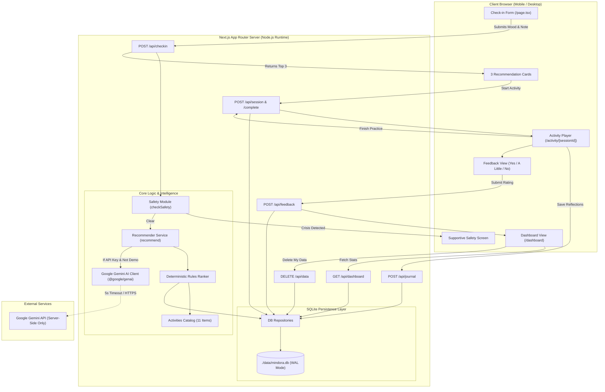
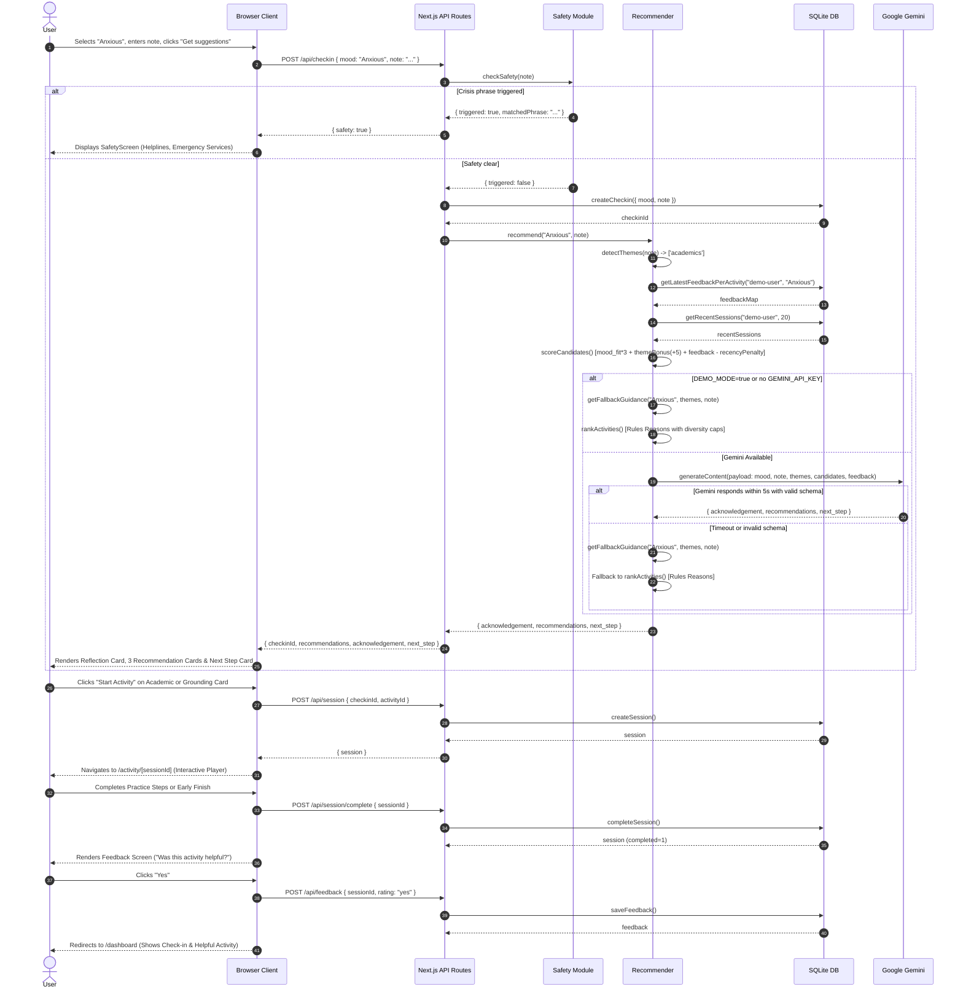

# Software Requirements Specification (SRS) for Mindora

**Document Reference:** IEEE 830-1998 Compliant  
**Project Name:** Mindora — Personalized Wellbeing Coach  
**Version:** 1.0.0  
**Date:** November 24, 2026  
**Status:** Approved / Implemented  

---

## Table of Contents

1. [Introduction](#1-introduction)
   - 1.1 [Purpose](#11-purpose)
   - 1.2 [Scope](#12-scope)
   - 1.3 [ONE Core Problem Statement](#13-one-core-problem-statement)
   - 1.4 [Definitions, Acronyms, and Abbreviations](#14-definitions-acronyms-and-abbreviations)
   - 1.5 [References](#15-references)
   - 1.6 [Document Overview](#16-document-overview)
2. [Overall Description](#2-overall-description)
   - 2.1 [Product Perspective](#21-product-perspective)
   - 2.2 [Product Functions (The User Journey)](#22-product-functions-the-user-journey)
   - 2.3 [Stakeholders & User Characteristics](#23-stakeholders--user-characteristics)
   - 2.4 [Constraints](#24-constraints)
   - 2.5 [Assumptions and Dependencies](#25-assumptions-and-dependencies)
   - 2.6 [Out-of-Scope (Non-Goals)](#26-out-of-scope-non-goals)
3. [Specific Requirements: Functional Requirements](#3-specific-requirements-functional-requirements)
   - [FR-1: Mood Check-in & Input Validation](#fr-1-mood-check-in--input-validation)
   - [FR-2: Phrase-Based Crisis Interception](#fr-2-phrase-based-crisis-interception)
   - [FR-3: Hybrid Activity Recommendation Engine](#fr-3-hybrid-activity-recommendation-engine)
   - [FR-4: Interactive Multi-Modal Activity Player](#fr-4-interactive-multi-modal-activity-player)
   - [FR-5: Practice Completion & Feedback Logging](#fr-5-practice-completion--feedback-logging)
   - [FR-6: Longitudinal Wellbeing Dashboard](#fr-6-longitudinal-wellbeing-dashboard)
   - [FR-7: Right to Erasure (Delete User Data)](#fr-7-right-to-erasure-delete-user-data)
   - [FR-8: Idempotent Database Seeding](#fr-8-idempotent-database-seeding)
   - [FR-9: Note-Based Theme Detection & Situational Guidance](#fr-9-note-based-theme-detection--situational-guidance)
   - [FR-10: Structured AI Evaluation & Status Telemetry](#fr-10-structured-ai-evaluation--status-telemetry)
   - [FR-11: Follow-Up Recommendation Chat & Constraint Refinement](#fr-11-follow-up-recommendation-chat--constraint-refinement)
   - [FR-12: Personalized Everyday Suggestions ("Suggestions for you")](#fr-12-personalized-everyday-suggestions-suggestions-for-you)
4. [Specific Requirements: Non-Functional Requirements](#4-specific-requirements-non-functional-requirements)
   - [NFR-1: Safety & Medical Non-Claim Integrity](#nfr-1-safety--medical-non-claim-integrity)
   - [NFR-2: Privacy & Data Protection](#nfr-2-privacy--data-protection)
   - [NFR-3: Performance & Response Latency](#nfr-3-performance--response-latency)
   - [NFR-4: Usability & Accessibility](#nfr-4-usability--accessibility)
   - [NFR-5: Reliability, Fault Tolerance & Graceful Degradation](#nfr-5-reliability-fault-tolerance--graceful-degradation)
5. [Use Cases](#5-use-cases)
   - [UC-1: Routine Check-in to Grounding Practice](#uc-1-routine-check-in-to-grounding-practice)
   - [UC-2: Emergency Crisis Interception](#uc-2-emergency-crisis-interception)
   - [UC-3: User Data Erasure](#uc-3-user-data-erasure)
6. [Data Model & Schema Specifications](#6-data-model--schema-specifications)
   - 6.1 [Entity Relationship Overview](#61-entity-relationship-overview)
   - 6.2 [SQLite Database Schema](#62-sqlite-database-schema)
   - 6.3 [Curated Catalog Schema](#63-curated-catalog-schema)
7. [System Architecture & Sequence Diagrams](#7-system-architecture--sequence-diagrams)
   - 7.1 [Mermaid Architecture Diagram](#71-mermaid-architecture-diagram)
   - 7.2 [Mermaid Main Journey Sequence Diagram](#72-mermaid-main-journey-sequence-diagram)
8. [Requirements-to-Test Traceability Matrix](#8-requirements-to-test-traceability-matrix)

---

## 1. Introduction

### 1.1 Purpose
This Software Requirements Specification (SRS) defines the functional and non-functional requirements for **Mindora**, a personalized wellbeing coach application. It serves as the definitive reference for developers, testers, and stakeholders, detailing the system architecture, core behavioral rules, data storage models, and verification criteria.

### 1.2 Scope
Mindora is a lightweight web application that enables individuals experiencing everyday stress to check in with their mood and immediately receive three explained, feedback-aware activity recommendations. The system encompasses:
- An accessible mobile-first frontend (Next.js App Router, TypeScript, Tailwind CSS).
- A local SQLite database (`./data/mindora.db`) operated through `better-sqlite3`.
- A two-tier hybrid recommender: deterministic rule-based ranking combined with optional server-side LLM explanation via Google Gemini (`@google/genai`).
- Multi-modal interactive activity players (Breathing, Grounding, Journaling, Movement Break).
- A phrase-based safety interception mechanism.
- An analytics dashboard with complete user data erasure capabilities.

### 1.3 ONE Core Problem Statement
> **People under everyday stress cannot easily decide which simple wellbeing activity suits their mood; Mindora reduces this friction to a single check-in and three explained, feedback-aware suggestions.**

Mindora eliminates choice overload by filtering an 11-activity catalog down to exactly three context-sensitive practices, accompanied by clear, non-clinical explanations of why each practice was suggested.

### 1.4 Definitions, Acronyms, and Abbreviations
- **AGY**: Google Antigravity Agentic Platform.
- **API**: Application Programming Interface.
- **CRUD**: Create, Read, Update, Delete.
- **E2E**: End-to-End testing (executed via Playwright).
- **LLM**: Large Language Model (Google Gemini).
- **Mood**: One of five standardized affective states: `Anxious`, `Stressed`, `Sad`, `Overwhelmed`, `Okay`.
- **Rating**: Three-point discrete user feedback: `yes` (+2 score), `a_little` (+1 score), `no` (-2 score).
- **SRS**: Software Requirements Specification (IEEE 830-1998).
- **WAL**: Write-Ahead Logging (SQLite concurrency mode).

### 1.5 References
- [PROJECT_CONTEXT.md](file:///d:/Mindora/docs/PROJECT_CONTEXT.md): System foundational specification.
- [test-results.md](file:///d:/Mindora/docs/test-results.md): Measured test execution and coverage reports.
- IEEE Std 830-1998: IEEE Recommended Practice for Software Requirements Specifications.

### 1.6 Document Overview
Section 2 provides high-level product constraints, user characteristics, and non-goals. Section 3 enumerates functional requirements (FR-1 to FR-8). Section 4 defines non-functional requirements (NFR-1 to NFR-5). Section 5 outlines detailed use cases. Section 6 specifies the data model. Section 7 presents Mermaid architecture and sequence diagrams. Section 8 details the complete traceability matrix mapping requirements to test suites.

---

## 2. Overall Description

### 2.1 Product Perspective
Mindora is an autonomous, standalone web application. It runs locally without external infrastructure dependencies except when optionally querying Google Gemini for AI-generated recommendation rationales. All user data is held strictly on the local filesystem in SQLite (`./data/mindora.db`).

### 2.2 Product Functions (The User Journey)
The primary user journey consists of five sequential steps:
1. **Mood Check-in:** The user selects one of five moods and optionally enters an unconstrained thought note ($\le 300$ chars).
2. **Safety Evaluation:** The system evaluates the input. If crisis ideation is detected, the safety screen intercepts the user immediately without persisting data or calling the recommender.
3. **Three Explained Recommendations:** If clear, the recommender ranks activities based on mood match, previous feedback scores, and recent completion penalties, presenting three cards with reasons and an `AI` or `Rules` badge.
4. **Interactive Practice Execution:** The user launches a selected activity into an active player featuring a persistent **Stop** control.
5. **Feedback & Dashboard Reflection:** Upon completion, the user logs a single-tap feedback rating (`yes`, `a_little`, `no`), which immediately updates the persistent dashboard and recalculates future ranking weights.

### 2.3 Stakeholders & User Characteristics
- **End Users:** Everyday individuals experiencing workplace pressure, cognitive fatigue, academic tension, or emotional heaviness. Users require low-friction UI, large touch targets, zero cognitive overhead, and zero clinical jargon.
- **Developers & Auditors:** Engineers validating that health non-claim disclaimers, data minimization, and safety guardrails remain intact across all revisions.

### 2.4 Constraints
- **Runtime Environment:** Next.js App Router (Node.js runtime enforced via `export const runtime = "nodejs"` on all route handlers).
- **Database Engine:** `better-sqlite3` strictly. ORMs such as Prisma or Drizzle are explicitly prohibited.
- **Persistence Path:** Configurable via `DATABASE_PATH` (defaulting to `./data/mindora.db`, or `/var/data/mindora.db` when mounted on a persistent disk) with automatic directory creation.
- **Authentication Model:** No authentication layer; single hardcoded seeded user `demo-user`. Every database table enforces a `user_id` column.
- **AI Integration:** Google Gemini via `@google/genai` executed server-side only; bypassed whenever `DEMO_MODE=true` or when `GEMINI_API_KEY` is unset.
- **Deployment:** Configured for single-instance Node.js hosting (e.g. Render Web Service via `render.yaml`) because SQLite runs embedded on local disk. In public demo deployments, data is shared under `demo-user` and may reset on ephemeral filesystems without a persistent disk (`SEED_ON_START=true` re-populates empty databases on startup).

### 2.5 Assumptions and Dependencies
- Client devices support modern CSS (Flexbox, Grid, CSS transitions) with JavaScript enabled.
- The hosting environment runs Node.js `>=20` on a single instance with a writeable local or mounted filesystem for the SQLite database (ephemeral disks on free tiers reset on restarts unless an optional persistent disk is attached).
- Network access is required only when utilizing Google Gemini API; in offline environments, the system functions seamlessly via rule-based ranking.

### 2.6 Out-of-Scope (Non-Goals)
- **NO Medical Diagnosis or Treatment:** Mindora does not diagnose depression, anxiety disorders, PTSD, or any clinical psychiatric condition.
- **NO Emergency Dispatch:** Mindora is not a 911/999/112 dispatcher and cannot contact first responders directly.
- **NO User Multi-Tenancy / Passwords:** No authentication, password hashing, session tokens, or JWTs.
- **NO Social Features:** No community feeds, sharing to social networks, or leaderboards.

---

## 3. Specific Requirements: Functional Requirements

### FR-1: Mood Check-in & Input Validation
- **FR-1.1:** The system shall display five mutually exclusive mood options: `Anxious`, `Stressed`, `Sad`, `Overwhelmed`, and `Okay`.
- **FR-1.2:** Each mood option shall be visually distinct, using dedicated color themes, icons, and descriptive subtitles.
- **FR-1.3:** The system shall provide an optional text input allowing users to describe their state in up to 300 characters. Text exceeding 300 characters shall be rejected by Zod schema validation or truncated.
- **FR-1.4:** The system shall display a local storage and AI usage disclosure below the check-in form before submission.

### FR-2: Phrase-Based Crisis Interception
- **FR-2.1:** The system shall execute `checkSafety(note)` server-side **before** recording any check-in or contacting the recommender.
- **FR-2.2:** The safety module shall match against a curated list of crisis phrases (`src/lib/safety/phrases.ts`) covering suicide, self-harm, wishing for death, ending one's life, and harming others.
- **FR-2.3:** The matching algorithm shall normalize unicode, casing, whitespace, and punctuation, matching whole phrases with word boundaries while never triggering on isolated words (e.g., *"kill"*, *"hurt"*, *"dying"*).
- **FR-2.4:** If a crisis phrase is matched, the API shall return `{ safety: true }`. The system shall **not** persist the note, shall **not** record a check-in, and shall **not** invoke Google Gemini.
- **FR-2.5:** When safety is triggered, the UI shall render the `SafetyScreen` displaying non-country-specific emergency contacts (Trusted Person, Local Crisis Helplines 988/111/116 123/findahelpline.com, Local Emergency Services) and a button to return to check-in.

### FR-3: Hybrid Activity Recommendation Engine
- **FR-3.1:** The system shall maintain a curated catalog of 22 activities (`src/lib/catalog/activities.json`), each defining a duration, activity type (`breathing`, `grounding`, `journaling`, `break`), step-by-step guidance, situation themes (`target_themes`), and a weighted mood fit map (`mood_fit: Partial<Record<Mood, 1 | 2 | 3>>` where 3 = primary fit, 2 = good fit, 1 = weak fit, omitted = no fit). No activity shall possess a fit for more than three moods, and every mood shall have at least three activities with primary fit 3.
- **FR-3.2:** The deterministic rules engine shall score candidate activities using:
  $$\text{Score} = (\text{Mood Fit} \times 3) + \text{Theme Bonus} + \text{Feedback Preference} - \text{Recent Practice Penalty}$$
  - **Mood Fit Dominance:** Mood fit strictly dominates feedback ($\text{fit} \times 3 \in \{3, 6, 9\}$); no feedback value can lift a non-matching activity ($\text{fit} = 0$) above an activity with primary fit ($\text{fit} = 3$).
  - **Theme Bonus:** Candidate activities with matching `target_themes` and $\text{mood\_fit} \ge 1$ receive a $+5$ bonus.
  - **Mood-Aware Feedback Preference:** Feedback given under the identical mood counts at full weight ($1.0\times$), whereas feedback recorded under a different mood counts at half weight ($0.5\times$). Effective preference values are clamped to $[-2.0, +2.0]$.
  - **Recent Practice Penalty:** $-1.5$ penalty if the activity was completed within the preceding 24 hours.
  - **Diversity Rules:** Top 3 recommendations contain at most 2 activities of the same type, and mood `Okay` shall never return exclusively breathing or grounding exercises.
  - **Deterministic Tie-Breaking:** Alphabetical comparison by `activity.id`.
- **FR-3.3:** If `DEMO_MODE=true` or `GEMINI_API_KEY` is not configured, the system shall return the top 3 scored activities accompanied by warm, non-clinical templated reasons and `personalised_by: "rules"`.
- **FR-3.4:** If `GEMINI_API_KEY` is present and `DEMO_MODE!=true`, the system shall transmit candidate activities, user mood, optional note, detected themes, and an anonymized feedback summary to Google Gemini (`GEMINI_MODEL`). Identifying user attributes and raw database IDs are never transmitted.
- **FR-3.5:** The Gemini integration shall enforce an 8000ms timeout (`Promise.race`), JSON mime-type enforcement, schema validation via Zod, verify that exactly 3 distinct valid candidate IDs from the 6-item candidate pool are returned, and enforce word count limits: `acknowledgement` $\le 60$ words, `reasons` $\le 25$ words referring to the user's situation, and `next_step` $\le 30$ words, returning `personalised_by: "ai"`.
- **FR-3.6:** On any AI exception, parsing error, unknown ID, duplicate ID, over-length string, or timeout, the system shall execute 1 retry on malformed JSON and seamlessly fall back to rule-based recommendations with `personalised_by: "rules"` and situation-specific fallback guidance.

### FR-4: Interactive Multi-Modal Activity Player
- **FR-4.1:** The player (`/activity/[sessionId]`) shall prominently display a persistent **Stop** control in the top navigation bar at all times across all activity types.
- **FR-4.2 (Breathing):** The player shall render an animated expanding and contracting visual circle synchronized to activity-specific timing phases:
  - *Box Breathing:* 4s Inhale, 4s Hold, 4s Exhale, 4s Hold.
  - *4-7-8 Breathing:* 4s Inhale, 7s Hold, 8s Exhale.
  - *Physiological Sigh:* 2s Deep Inhale, 1s Top Inhale, 4s Exhale.
- **FR-4.3 (Breathing Controls):** The breathing player shall display the current phase label, countdown timer, total remaining time, Pause/Resume button, and a *"Finish Early"* button.
- **FR-4.4 (Grounding):** The player shall present a step-by-step wizard utilizing the activity's `steps` array, featuring a step progress counter, Back button, Next button, and a final *"Complete Practice"* button.
- **FR-4.5 (Journaling):** The player shall present an unpressured reflection prompt, a private textarea, character counter, and a *"Save & Finish"* button calling `POST /api/journal`.
- **FR-4.6 (Break):** The player shall present a countdown timer, gentle step-by-step movement/hydration suggestions, and Pause/Finish controls.

### FR-5: Practice Completion & Feedback Logging
- **FR-5.1:** Upon finishing an activity, the system shall mark the session completed (`completed = 1`, `completed_at = ISO timestamp`) via `POST /api/session/complete`.
- **FR-5.2:** The system shall display the Feedback screen prompting: *"Was this activity helpful?"* with three options: `Yes`, `A little`, and `No`.
- **FR-5.3:** Selecting an option shall submit `POST /api/feedback` with `{ sessionId, rating }` and navigate the user to `/dashboard`.

### FR-6: Longitudinal Wellbeing Dashboard
- **FR-6.1:** The `/dashboard` route shall query `GET /api/dashboard` and display aggregated statistics: total sessions, completed sessions, total mindful minutes practiced, and completion rate percentage.
- **FR-6.2:** The dashboard shall display a visual mood history distribution showing total counts for each of the five moods using their dedicated color themes.
- **FR-6.3:** The dashboard shall render a chronologically ordered list of recent check-ins with mood badges, timestamps, and note snippets.
- **FR-6.4:** The dashboard shall render a list of recent sessions displaying activity titles, completion statuses, user feedback badges (`Helpful`, `A little`, `Not helpful`), and private journal reflections.
- **FR-6.5:** The dashboard shall present a prominent *"Check In Again"* button linking to `/`.

### FR-7: Right to Erasure (Delete User Data)
- **FR-7.1:** The dashboard shall provide a *"Delete my data"* button.
- **FR-7.2:** Clicking *"Delete my data"* shall open a confirmation dialog explaining that all check-ins, sessions, feedback, and journal notes will be permanently erased.
- **FR-7.3:** Confirming deletion shall invoke `DELETE /api/data`, executing an atomic database transaction that removes all records from `journal_entries`, `feedback`, `sessions`, and `checkins` for `demo-user`.
- **FR-7.4:** The database seeder shall retain or immediately recreate the base user record (`users.id = 'demo-user'`) so foreign key constraints remain valid for subsequent check-ins.
- **FR-7.5:** The dashboard UI shall dynamically update to reflect zero counts across all metrics upon successful deletion.

### FR-8: Idempotent Database Seeding
- **FR-8.1:** The project shall provide an executable seed script accessible via `npm run seed`.
- **FR-8.2:** The seed script shall insert seven check-ins, seven completed sessions, seven feedback records, and three journal reflections across multiple days using deterministic primary keys (`seed-checkin-1`..`7`, `seed-session-1`..`7`, etc.).
- **FR-8.3:** Executing `npm run seed` repeatedly shall execute via `INSERT OR REPLACE`, strictly creating zero duplicate rows.
- **FR-8.4:** The seed dataset shall establish active feedback preferences: `box-breathing` (`yes`), `body-scan` (`no`), and `brain-dump` (`a_little`).

### FR-9: Note-Based Theme Detection & Situational Guidance
- **FR-9.1 (Theme Detection):** The system shall implement `detectThemes(note)` using an extensible keyword and phrase mapping (`src/lib/recommender/themeKeywords.ts`) recognizing eight situational themes: `academics`, `work`, `sleep`, `relationships`, `loneliness`, `health_worry`, `money`, and `general`.
- **FR-9.2 (Matching Semantics):** Keyword detection shall be case-insensitive, whole-word matching, returning an ordered array of matching themes, and strictly returning `[]` for empty or unrelated notes.
- **FR-9.3 (Situational Bonus):** When situational themes are detected, activities possessing matching `target_themes` with $\text{mood\_fit} \ge 1$ shall receive a $+5$ score bonus, surfacing situation-specific activities (e.g. academic micro-steps and focus sprints for academic pressure notes).
- **FR-9.4 (Calm Acknowledgement Card):** The system shall deliver a warm, empathetic reflection (`acknowledgement`, $\le 60$ words) reflecting the user's situation without diagnosis, judgment, or clinical labeling, rendered in a dedicated calm card above the three recommendation cards.
- **FR-9.5 (Concrete Next Step Card):** The system shall deliver one concrete, low-effort micro-action (`next_step`, $\le 30$ words) relevant to the situation, rendered in a dedicated card below the recommendation cards titled *"One small step for today"*.
- **FR-9.6 (Provenance Visibility):** The UI shall display an explicit provenance badge (`AI` or `Rules`) on the acknowledgement card, the next step card, and each activity card.
- **FR-9.7 (Deterministic Guidance Fallback):** When AI personalization is unavailable (`DEMO_MODE=true` or missing API key) or on any AI validation failure, the system shall provide situation-specific templated guidance (`THEME_FALLBACK_TEMPLATES`) tailored by user mood and detected themes.

### FR-10: Structured AI Evaluation & Status Telemetry
- **FR-10.1 (Status Telemetry):** The system shall expose `GET /api/status` returning the operational recommender mode (`{ mode: "ai" | "rules" }`) without exposing API keys, secret credentials, or environment paths.
- **FR-10.2 (Engine State Badge):** The check-in interface shall fetch and render a real-time operational badge indicating engine state: *"AI personalisation: on"* (emerald badge) when Gemini is active, or *"Rules mode"* (stone badge) when operating deterministically.
- **FR-10.3 (Candidate Pool Isolation):** When generating AI recommendations, the system shall pass only the top 6 candidate activities pre-filtered by `rankActivities` ($\text{mood\_fit} \ge 1$, incorporating situational theme bonus and mood-aware feedback, without early diversity capping). The LLM may strictly select only from these 6 candidates.
- **FR-10.4 (Structured Evaluation Schema):** The Gemini model shall be constrained to return valid JSON conforming to:
  $$\{\text{"understanding"}: \{\text{"main\_concern"}: \text{str}, \text{"intensity"}: \text{"low" | "medium" | "high"}, \text{"need"}: \text{"calm" | "focus" | "comfort" | "connection" | "energy" | "reflect"}\}, \text{"acknowledgement"}: \text{str}, \text{"recommendations"}: [\{\text{"activity\_id"}: \text{str}, \text{"reason"}: \text{str}\}], \text{"next\_step"}: \text{str}\}$$
- **FR-10.5 (Non-Clinical Intensity Handling):** `understanding.intensity` shall characterize situational weight in the note without clinical assessment or diagnosis. If intensity is evaluated as "high", the top recommendation shall be the gentlest/shortest fit, and the acknowledgement shall gently encourage speaking with a trusted person (explicitly avoiding crisis labeling).
- **FR-10.6 (Post-AI Diversity Enforcement):** Recommendations returned by AI shall undergo post-processing enforcing that at most 2 activities share the same type, backfilling any 3rd duplicate type from remaining unchosen items in the 6-candidate pool.
- **FR-10.7 (Need Tag Telemetry):** The recommendations view shall display an explicit situational need tag (`data-testid="need-tag"`, e.g. *"Looks like you need: focus"*).
- **FR-10.8 (Resilience & Retry):** The AI module shall execute with an 8000ms abort timeout (`Promise.race`) and support 1 automatic retry on invalid JSON before gracefully falling back to deterministic rules.

### FR-11: Follow-Up Recommendation Chat & Constraint Refinement
- **FR-11.1 (Follow-up Chat Endpoint):** The system shall expose `POST /api/chat` accepting `{ checkinId: string, message: string, history?: ChatMessage[] }` (message $\le 300$ chars, history $\le 6$ turns) with strict Zod validation and Node runtime.
- **FR-11.2 (Pre-Processing Safety Gate):** The system shall evaluate `checkSafety(message)` **first** on every chat submission. If triggered, the API shall return `{ safety: true }`, make zero Gemini calls, persist zero records, and the client UI shall immediately render the Safety Screen.
- **FR-11.3 (Server-Side Context Retrieval):** The handler shall retrieve the check-in's mood, note, and detected themes directly from the database; the endpoint shall **never** accept client-supplied mood or note parameters.
- **FR-11.4 (Pure Rule Intent Parsing):** The system shall implement `parseConstraints(message)` (`src/lib/chat/intent.ts`) returning `{ max_minutes?, exclude_types[], include_types[], wants_swap, wants_why, wants_steps }` via case-insensitive whole-phrase matching.
- **FR-11.5 (Constraint-Aware Activity Ranking):** `rankActivitiesWithConstraints` shall filter candidate activities by `max_minutes`, excluded types, and for `wants_swap` exclude currently displayed activity IDs while preserving mood fit dominance ($\text{mood\_fit} \ge 1$), theme bonuses, and deterministic tie-breaks. If fewer than 3 activities match, the system shall progressively relax constraints (swap $\rightarrow$ duration $\rightarrow$ type) and append a relaxation explanation.
- **FR-11.6 (AI & Templated Fallback Refinement):** If `DEMO_MODE=true` or `GEMINI_API_KEY` is absent, the system shall construct templated responses tailored to the parsed constraints (explaining why via activity reasons, providing activity steps, or naming the new top card) with `personalised_by: "rules"`. When Gemini is active, Gemini shall return structured JSON (`{ reply, constraints }`) within a 5000ms timeout; constraints are merged with rule-parsed filters before ranking. Any parsing failure or timeout cleanly falls back to rule templates.
- **FR-11.7 (Interactive Chat UI & Limit):** The recommendations view shall render a dedicated *"Want to adjust these?"* chat panel below recommendation cards featuring:
  - Accessible 300-character input field and character counter.
  - Visible 6-message session limit; once reached, further chat inputs are disabled.
  - Quick-reply chips (*"Shorter please"*, *"No breathing exercises"*, *"Something different"*, *"Why these?"*).
  - Calm bot response bubbles with provenance badges (`AI` or `Rules`) and `aria-live="polite"` screen reader announcements.
  - In-place recommendation card replacement with a temporary visual highlight animation.
  - Explicit disclaimer: *"This chat only adjusts your suggestions. It isn't therapy or an emergency service."*

### FR-12: Personalized Everyday Suggestions ("Suggestions for you")
- **FR-12.1 (Gemini Schema Extension):** The check-in evaluation prompt shall instruct Gemini to return a `suggestions` array containing exactly 3 items within the same single API call:
  $$\text{"suggestions"}: [\{\text{"title"}: \text{str (}\le 6\text{ words)}, \text{"detail"}: \text{str (}\le 35\text{ words)}, \text{"when"}: \text{"now" | "today" | "this\_week"}\}]$$
  The output shall mix timeframes with at least one `"now"` (under 5 minutes) and at least one `"today"`. Suggestions must remain completely distinct from the 3 curated activity cards and distinct from `next_step`.
- **FR-12.2 (Safe Non-Clinical Content Integrity):** Suggestions shall strictly propose everyday wellbeing ideas. The system prompt and validation layers strictly forbid diagnostic statements, clinical labels, medical or pharmacological advice (medications, pills, antidepressants, supplements), restrictive diets, and curative guarantees. If situational intensity is `"high"`, at least one suggestion must recommend reaching out to a trusted friend, family member, or colleague.
- **FR-12.3 (Decoupled Partial Fallback Architecture):** The system shall evaluate the `suggestions` array independently from activity recommendations. If suggestions fail schema validation (wrong item count, length overflow, invalid `when`) or trigger crisis/medical phrase detection, the recommender shall drop only the suggestions to rules templates (`suggestions_by: "rules"`) while preserving the 3 AI-personalized recommendation cards (`personalised_by: "ai"`).
- **FR-12.4 (Comprehensive 40-Combination Fallback Library):** When AI is inactive (`DEMO_MODE=true` or missing API key) or on fallback, the system shall draw from a static matrix of 40 distinct combinations ($5\text{ moods} \times 8\text{ themes}$), providing 3 contextual, low-effort suggestions with compliant word counts and mixed timeframes.
- **FR-12.5 (UI Presentation Order & Dedicated Disclaimer):** The recommendations view shall render sections in strict order:
  1. Reflection acknowledgement card
  2. Identified need tag (`Looks like you need: X`)
  3. 3 curated activity recommendation cards
  4. *"Suggestions for you"* section with 3 cards displaying timeframe badge (`Now`, `Today`, `This week`), title, detail, provenance tag (`AI-written` or `Template`), and dedicated disclaimer:
     > *"These ideas are AI-generated everyday suggestions, not medical or professional advice."*
  5. Follow-up chat panel (`Want to adjust these?`)
  6. Concrete micro-action card (`One small step for today`)
- **FR-12.6 (Follow-Up Chat Decoupling):** Everyday suggestions are generated once during the check-in call. They remain visible, static, and intact when the user interacts with the follow-up chat to adjust, swap, or filter the 3 curated activity cards. `/api/chat` neither generates, returns, nor modifies suggestions.

---

## 4. Specific Requirements: Non-Functional Requirements

### NFR-1: Safety & Medical Non-Claim Integrity
- **NFR-1.1:** Every page of the application shall display the verbatim disclaimer in the footer:
  > *"Mindora is for everyday wellbeing support. It isn't a therapist, medical service, or emergency service."*
- **NFR-1.2:** The application shall contain zero clinical claims, diagnostic questionnaires, or medical advice across all client text, system prompts, and recommendation rationales.
- **NFR-1.3:** The crisis trigger shall be explicitly documented in source code as a basic keyword heuristic, not a clinical risk assessment.
- **NFR-1.4:** Everyday suggestions in the *"Suggestions for you"* section shall strictly offer low-effort routine habits and interpersonal connections, accompanied by their own prominent disclaimer stating they are AI-generated everyday ideas and not medical advice.

### NFR-2: Privacy & Data Protection
- **NFR-2.1:** All check-in notes and journal text shall reside strictly on the user's host filesystem in SQLite.
- **NFR-2.2:** Server-side route handlers and repositories shall **never** log check-in notes or journal entries to standard output, standard error, or log files.
- **NFR-2.3:** Outbound calls to Google Gemini shall omit all user identifiers, timestamps, IP addresses, and session IDs. Only `mood`, `note`, candidate activity summaries (top 6), and anonymized feedback ratings (`liked`, `neutral`, `disliked`) shall be transmitted.
- **NFR-2.4:** Standard output and application logs strictly omit notes, prompts, and raw LLM responses. On failure, only normalized category identifiers (`missing key`, `invalid key`, `quota`, `timeout`, `bad JSON`) are logged.
- **NFR-2.5:** Chat messages and bot responses in the follow-up adjustment chat reside solely in client component state for the duration of the view. Chat text is **never** saved to SQLite, never persisted in files, and never logged to stdout, stderr, or server logs.

### NFR-3: Performance & Response Latency
- **NFR-3.1:** The journey time from loading the application homepage to launching an interactive activity shall execute in $\le 3$ user taps and $\le 5.0$ seconds of total processing latency in automated end-to-end browser environments.
- **NFR-3.2:** Deterministic rule-based activity ranking shall execute in $\le 5$ milliseconds.
- **NFR-3.3:** Outbound LLM requests to Google Gemini shall enforce an unyielding 8000ms abort timeout, falling back instantly to rule-based ranking.

### NFR-4: Usability & Accessibility
- **NFR-4.1:** The user interface shall adhere to mobile-first responsive design, maintaining full legibility and touch target ergonomics across viewport widths from 320px to 4K displays.
- **NFR-4.2:** Form inputs and mood radio selectors shall implement explicit ARIA attributes (`role="radio"`, `aria-checked`, `aria-label`) and visible keyboard focus indicators (`focus-visible:ring-2`).
- **NFR-4.3:** All animated UI elements, including the breathing player circle, shall respect user operating system motion preferences via Tailwind `motion-reduce:animate-none` and `motion-reduce:transition-none`.

### NFR-5: Reliability, Fault Tolerance & Graceful Degradation
- **NFR-5.1:** The SQLite database connection shall initialize with `PRAGMA journal_mode = WAL;` and `PRAGMA foreign_keys = ON;`, preventing file locking contention.
- **NFR-5.2:** On any failure of the Google Gemini API (rate limiting, quota exhaustion, network disruption, malformed JSON, schema mismatch), the application shall complete the request transparently using rules-based ranking without surfacing error alerts to the user.
- **NFR-5.3:** Direct URL navigation to `/activity/[sessionId]` shall reload session and activity state cleanly from `GET /api/session?id=...`.

---

## 5. Use Cases

### UC-1: Routine Check-in to Grounding Practice
- **Actor:** Everyday User.
- **Preconditions:** Mindora is running at `http://localhost:3000`; database initialized.
- **Normal Flow:**
  1. User accesses `/` and reviews the 5 mood cards.
  2. User selects `Anxious` (Tap 1).
  3. User enters an optional thought: *"Feeling butterflies before my presentation"*.
  4. User clicks *"Get suggestions"* (Tap 2).
  5. System evaluates `checkSafety()` $\rightarrow$ False.
  6. Recommender evaluates candidates and displays 3 activity cards with reasons.
  7. User clicks *"Start Activity"* on `5-4-3-2-1 Grounding` (Tap 3).
  8. System creates session via `POST /api/session` and navigates to `/activity/[sessionId]`.
  9. User steps through the 5 sensory steps and clicks *"Complete Practice"*.
  10. System marks session complete via `POST /api/session/complete` and renders Feedback screen.
  11. User clicks *"Yes"* (Helpful).
  12. System records feedback via `POST /api/feedback` and redirects to `/dashboard`.
  13. Dashboard reflects updated stats and historical entry with *"Helpful"* badge.
- **Postconditions:** Session completed, feedback logged, subsequent rankings boost `5-4-3-2-1 Grounding` by +2.

### UC-2: Emergency Crisis Interception
- **Actor:** Distressed User.
- **Preconditions:** Mindora is running at `http://localhost:3000`.
- **Normal Flow:**
  1. User accesses `/` and selects `Overwhelmed`.
  2. User types: *"I cannot take this anymore, I want to end my life"*.
  3. User clicks *"Get suggestions"*.
  4. System executes `checkSafety()` $\rightarrow$ True (`matchedPhrase: "end my life"`).
  5. System returns `{ safety: true }`. Zero rows written to SQLite. Zero calls to Gemini.
  6. UI intercepts user and renders `SafetyScreen`.
  7. Screen displays supportive crisis helpline numbers and local emergency services guidance.
  8. Zero activity recommendations are generated or displayed.
  9. User clicks *"Return to Check-in"*, restoring clean check-in form.
- **Postconditions:** No personal data stored; user redirected toward professional human assistance.

### UC-3: User Data Erasure
- **Actor:** Privacy-Conscious User.
- **Preconditions:** User has check-ins and session history in `/dashboard`.
- **Normal Flow:**
  1. User navigates to `/dashboard`.
  2. User clicks *"Delete my data"*.
  3. Confirmation modal opens explaining permanent erasure.
  4. User clicks *"Delete Everything"*.
  5. Client sends `DELETE /api/data`.
  6. Server executes transaction deleting all `journal_entries`, `feedback`, `sessions`, and `checkins` for `demo-user`.
  7. Server confirms success.
  8. Dashboard re-renders with 0 completed sessions, 0 minutes practiced, and empty history.
- **Postconditions:** User historical data permanently removed from disk.

---

## 6. Data Model & Schema Specifications

### 6.1 Entity Relationship Overview
Mindora employs a relational data model with foreign key cascading deletes centered on the single user entity `demo-user`.

```
[users] 1 ────< [checkins] 0..1 ────< [sessions] 1 ────< [feedback]
   │                                        │
   └────────────────────────────────────────┴────< [journal_entries]
```

### 6.2 SQLite Database Schema (`src/lib/db/schema.ts`)

```sql
CREATE TABLE IF NOT EXISTS users (
  id TEXT PRIMARY KEY,
  created_at TEXT NOT NULL
);

CREATE TABLE IF NOT EXISTS checkins (
  id TEXT PRIMARY KEY,
  user_id TEXT NOT NULL,
  mood TEXT NOT NULL,
  note TEXT,
  created_at TEXT NOT NULL,
  FOREIGN KEY (user_id) REFERENCES users(id) ON DELETE CASCADE
);

CREATE TABLE IF NOT EXISTS sessions (
  id TEXT PRIMARY KEY,
  user_id TEXT NOT NULL,
  checkin_id TEXT,
  activity_id TEXT NOT NULL,
  started_at TEXT NOT NULL,
  completed_at TEXT,
  completed INTEGER NOT NULL DEFAULT 0,
  FOREIGN KEY (user_id) REFERENCES users(id) ON DELETE CASCADE,
  FOREIGN KEY (checkin_id) REFERENCES checkins(id) ON DELETE SET NULL
);

CREATE TABLE IF NOT EXISTS feedback (
  id TEXT PRIMARY KEY,
  user_id TEXT NOT NULL,
  session_id TEXT NOT NULL,
  rating TEXT NOT NULL,
  created_at TEXT NOT NULL,
  FOREIGN KEY (user_id) REFERENCES users(id) ON DELETE CASCADE,
  FOREIGN KEY (session_id) REFERENCES sessions(id) ON DELETE CASCADE
);

CREATE TABLE IF NOT EXISTS journal_entries (
  id TEXT PRIMARY KEY,
  user_id TEXT NOT NULL,
  session_id TEXT NOT NULL,
  prompt TEXT NOT NULL,
  text TEXT NOT NULL,
  created_at TEXT NOT NULL,
  FOREIGN KEY (user_id) REFERENCES users(id) ON DELETE CASCADE,
  FOREIGN KEY (session_id) REFERENCES sessions(id) ON DELETE CASCADE
);
```

### 6.3 Curated Catalog Schema (`src/lib/catalog/activities.json`)
The application defines 11 immutable wellbeing activities across four types:

| ID | Title | Type | Duration | Target Moods |
| :--- | :--- | :--- | :---: | :--- |
| `box-breathing` | Box Breathing | breathing | 2 min | Anxious, Stressed, Overwhelmed, Okay |
| `4-7-8-breathing` | 4-7-8 Breathing | breathing | 2 min | Anxious, Stressed, Overwhelmed, Sad |
| `physiological-sigh` | Physiological Sigh | breathing | 1 min | Stressed, Anxious, Overwhelmed, Okay |
| `5-4-3-2-1-grounding` | 5-4-3-2-1 Grounding | grounding | 3 min | Anxious, Overwhelmed, Stressed, Sad |
| `body-scan` | Body Scan | grounding | 3 min | Stressed, Overwhelmed, Sad, Okay |
| `release-unclench` | Release & Unclench | grounding | 2 min | Stressed, Overwhelmed, Anxious, Sad, Okay |
| `brain-dump` | Brain Dump | journaling | 3 min | Overwhelmed, Stressed, Anxious, Okay |
| `one-small-step` | One Small Next Step | journaling | 2 min | Overwhelmed, Sad, Stressed, Okay |
| `gratitude-moment` | Gratitude Moment | journaling | 2 min | Sad, Okay, Stressed, Anxious |
| `name-what-you-feel` | Name What You Feel | journaling | 2 min | Sad, Anxious, Overwhelmed, Stressed |
| `screen-movement-break` | Screen/Movement Break | break | 5 min | Stressed, Overwhelmed, Sad, Okay |

---

## 7. System Architecture & Sequence Diagrams

### 7.1 Mermaid Architecture Diagram



### 7.2 Mermaid Main Journey Sequence Diagram



---

## 8. Requirements-to-Test Traceability Matrix

Every functional and non-functional requirement defined in this specification maps directly to executable verification suites in the codebase:

| Req ID | Requirement Description | Verification Method | Primary Test File Reference | Status |
| :--- | :--- | :--- | :--- | :---: |
| **FR-1** | Mood Check-in & Input Validation | Unit & Integration | [tests/db.test.ts](file:///d:/Mindora/tests/db.test.ts)<br>[tests/journey.spec.ts](file:///d:/Mindora/tests/journey.spec.ts) | **PASSED** |
| **FR-2** | Crisis Interception & Safety Screen | Unit & E2E | [tests/safety.test.ts](file:///d:/Mindora/tests/safety.test.ts)<br>[tests/e2e-demo.spec.ts](file:///d:/Mindora/tests/e2e-demo.spec.ts) | **PASSED** |
| **FR-3** | Hybrid Recommender (22-activity catalog, mood_fit weighting, feedback dominance, diversity caps, AI rules fallback) | Unit & Mock AI | [tests/recommender.test.ts](file:///d:/Mindora/tests/recommender.test.ts)<br>[tests/themes.test.ts](file:///d:/Mindora/tests/themes.test.ts)<br>[tests/ai.test.ts](file:///d:/Mindora/tests/ai.test.ts) | **PASSED** |
| **FR-4** | Interactive Activity Players & Stop Control | E2E Browser | [tests/journey.spec.ts](file:///d:/Mindora/tests/journey.spec.ts)<br>[tests/e2e-demo.spec.ts](file:///d:/Mindora/tests/e2e-demo.spec.ts) | **PASSED** |
| **FR-5** | Session Completion & Feedback Scoring | Unit & E2E | [tests/db.test.ts](file:///d:/Mindora/tests/db.test.ts)<br>[tests/journey.spec.ts](file:///d:/Mindora/tests/journey.spec.ts) | **PASSED** |
| **FR-6** | Longitudinal Dashboard Aggregations | Unit & E2E | [tests/db.test.ts](file:///d:/Mindora/tests/db.test.ts)<br>[tests/file-db.test.ts](file:///d:/Mindora/tests/file-db.test.ts) | **PASSED** |
| **FR-7** | Delete All User Data (Atomic Wipe) | Integration & E2E | [tests/db.test.ts](file:///d:/Mindora/tests/db.test.ts)<br>[tests/e2e-demo.spec.ts](file:///d:/Mindora/tests/e2e-demo.spec.ts) | **PASSED** |
| **FR-8** | Idempotent Seeding & Non-Duplication | Unit & CLI | [tests/seed.test.ts](file:///d:/Mindora/tests/seed.test.ts) | **PASSED** |
| **FR-9** | Note Themes, Acknowledgement & Situational Guidance | Unit, Mock AI & E2E | [tests/themes.test.ts](file:///d:/Mindora/tests/themes.test.ts)<br>[tests/ai.test.ts](file:///d:/Mindora/tests/ai.test.ts)<br>[tests/e2e-demo.spec.ts](file:///d:/Mindora/tests/e2e-demo.spec.ts) | **PASSED** |
| **FR-10** | Structured AI Evaluation, Candidate Isolation & Status Telemetry | Unit, Mock AI & E2E | [tests/ai.test.ts](file:///d:/Mindora/tests/ai.test.ts)<br>[tests/journey.spec.ts](file:///d:/Mindora/tests/journey.spec.ts) | **PASSED** |
| **FR-11** | Follow-Up Recommendation Chat, Constraint Parsing & In-Place Refinement | Unit & E2E | [tests/chat.test.ts](file:///d:/Mindora/tests/chat.test.ts)<br>[tests/e2e-demo.spec.ts](file:///d:/Mindora/tests/e2e-demo.spec.ts) | **PASSED** |
| **FR-12** | Personalized Everyday Suggestions ("Suggestions for you", 3 timeframe-mixed ideas, rules fallback, chat decoupling) | Unit, Mock AI & E2E | [tests/ai.test.ts](file:///d:/Mindora/tests/ai.test.ts)<br>[tests/chat.test.ts](file:///d:/Mindora/tests/chat.test.ts)<br>[tests/e2e-demo.spec.ts](file:///d:/Mindora/tests/e2e-demo.spec.ts) | **PASSED** |
| **NFR-1** | Footer Disclaimer & Non-Medical Wording | E2E Assertions | [tests/journey.spec.ts](file:///d:/Mindora/tests/journey.spec.ts) | **PASSED** |
| **NFR-2** | Note Privacy & Non-Logging | Code Review & Unit | [tests/ai.test.ts](file:///d:/Mindora/tests/ai.test.ts) | **PASSED** |
| **NFR-3** | Time-to-Start ($\le 5$s) & Tap Count ($\le 3$) | E2E Telemetry | [tests/e2e-demo.spec.ts](file:///d:/Mindora/tests/e2e-demo.spec.ts)<br>[docs/test-results.md](file:///d:/Mindora/docs/test-results.md) | **PASSED** |
| **NFR-4** | Accessibility & Reduced Motion Support | E2E DOM Inspection | [tests/journey.spec.ts](file:///d:/Mindora/tests/journey.spec.ts) | **PASSED** |
| **NFR-5** | Graceful Degradation & Timeout Resiliency | Mock Unit Suite | [tests/ai.test.ts](file:///d:/Mindora/tests/ai.test.ts) | **PASSED** |

---

*End of Software Requirements Specification — Mindora v1.0.0*
